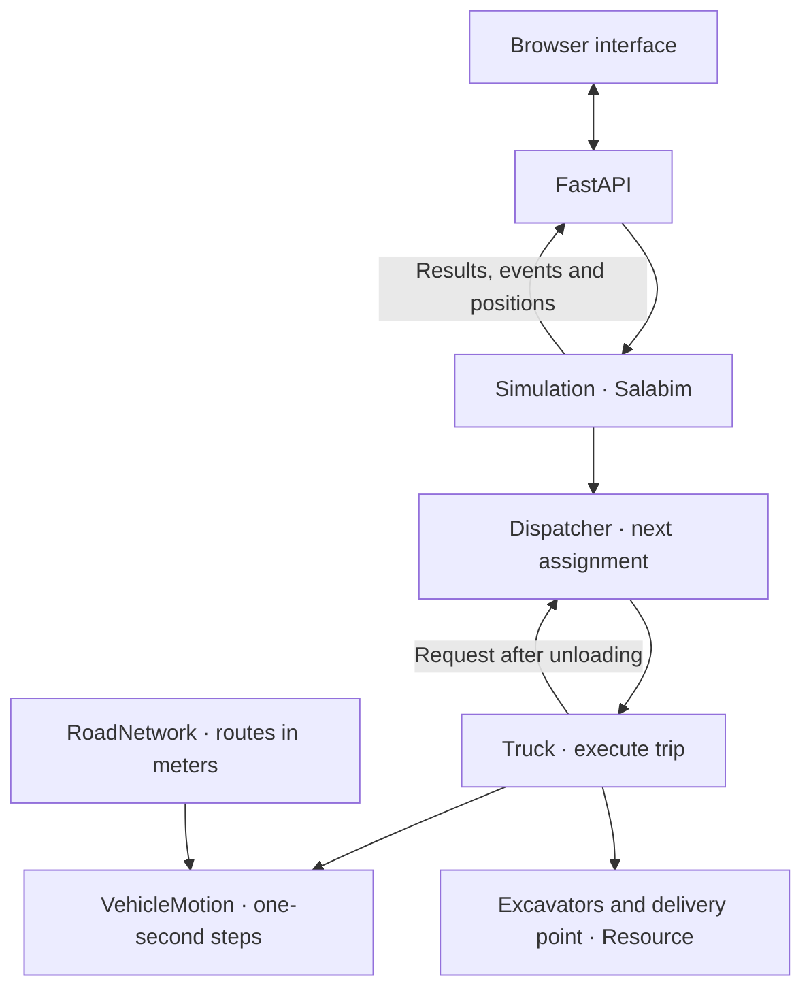

# Truck Optimization MVP (2024)

[English](README.md) | [Русский](README.ru.md)

A minimum viable product (MVP) for truck dispatch optimization with Salabim and FastAPI. It assigns trucks with different capacities and speeds to several excavators to deliver a target volume within a time budget. All routes, equipment and parameters are fictional.


## Architecture

`Simulation` runs the Salabim environment. `Dispatcher` gives each `Truck` its next assignment: an excavator, its route and a load volume. The truck travels, loads, returns and unloads, then requests another assignment. Assignments stop when the target volume is fully delivered or reserved, or when no estimated trip fits within the remaining time.



`RoadNetwork` stores the routes and distances. `VehicleMotion` handles leader following, acceleration and position updates. Salabim `Resource` objects allow one truck at a time to load at each excavator or unload at the delivery point. FastAPI returns the calculated positions and results; the browser displays them on the map. The CLI runs `Simulation` directly.

## Model

Each truck has its own capacity, empty speed limit and unloading time. The loaded speed limit is always half the empty limit. Each excavator has a loading rate and a distance to the shared delivery point. Trucks start at that delivery point, travel empty to an excavator, load, return with cargo and unload.

The dispatcher evaluates the next delivery time for each excavator. It includes travel, loading, reserved service slots and unloading. The earliest-delivery policy selects the earliest predicted unloading completion. A round-robin policy provides a simple comparison.

The dispatcher reserves expected service times for its estimates. Actual loading and unloading start when the truck reaches a free station. Each station serves one truck at a time. Loading time is load volume divided by the excavator's loading rate.

Movement uses one-second steps. On each step, a truck finds the closest leader on its route, calculates acceleration from speed and spacing, updates speed and position, then crosses to the next road section while preserving excess distance. Trucks slow down behind traffic and stop at their destination. Opposite directions use separate lanes. A truck waiting at a loading or unloading station remains in its arrival lane until it leaves.

Roads form a fictional network with a shared trunk, junctions and branches to the excavators. Node coordinates and edge lengths use meters: every line's geometric length equals its road distance. The map keeps one scale on both axes and includes a scale bar. Changing an excavator's distance rebuilds its route. Truck bodies represent a 15-meter vehicle; labels are enlarged for readability. Loaded trucks return along the same edges in reverse. Their speed limit is half the empty limit; acceleration, braking and queues also affect travel time.

A load counts toward the plan only after unloading finishes. Volume already assigned to trucks is reserved against the target. The final load can be smaller than truck capacity. A trip is issued only if its predicted unloading fits within the time budget.

The result includes delivered volume, deficit, time to reach the target, trips, truck working/waiting/idle time and excavator utilization. If the target is missed, the result reports the remaining volume for this policy. Earliest delivery is a greedy heuristic; it does not establish a global optimum or prove that a missed target is physically impossible. The current target is volume; material quality and blending are outside this version.

## Stack

Python 3.11+, Salabim 26.0.8 and a browser interface built with HTML, CSS and JavaScript. The API uses FastAPI and Pydantic, served by Uvicorn. Salabim processes use `yield` and `Environment(yieldless=False)`; see its [generator-mode documentation](https://salabim.org/manual_yield/Overview.html).

## Run

From the project directory:

```bash
python -m venv .venv
source .venv/bin/activate
python -m pip install -e .
python -m truck_cycle.web
```

Open [http://127.0.0.1:8765](http://127.0.0.1:8765). Edit the volume target, time budget and equipment parameters, then calculate the plan. Use pause, playback speed and the timeline to inspect assignments and queues. Stop the server with Ctrl+C. The viewer supports one to six trucks and one to four excavators through its scenario API; the form edits the supplied trucks.

The browser replays positions and events calculated by Salabim. It interpolates between recorded positions for smooth playback; it does not calculate motion itself. The forecast shows the final result; delivered volume and equipment activity follow the selected model time. Truck working time includes travel (including traffic stops), loading and unloading; waiting is shown separately. Excavator utilization is loading time divided by elapsed model time.

Or use Conda, from the project directory:

```bash
conda env create -f environment.yml
conda activate truck-cycle-demo
python -m truck_cycle.web
```

Run the default scenario from the command line:

```bash
python -m truck_cycle --target 120 --duration 1800
python -m truck_cycle --target 120 --duration 1800 --policy round_robin
python -m truck_cycle --target 120 --duration 1800 --events
```

`--target` is cubic meters; `--duration` is seconds. The default synthetic scenario has five trucks with capacities of 8, 12, 16, 10 and 14 m³, and three excavators rated at 144, 216 and 180 m³/h. Edit individual specifications through the form or construct a `Scenario` with `TruckSpec` and `ExcavatorSpec` in Python. All numeric parameters must be finite and positive.

## API

[Interactive API documentation](http://127.0.0.1:8765/docs) and the [OpenAPI schema](http://127.0.0.1:8765/openapi.json) are available while the server is running.

- `GET /api/defaults` returns the synthetic scenario.
- `POST /api/simulate` accepts a typed scenario and returns the plan, metric network, assignments, events and per-step motion samples. Assignment timestamps record actual progress; unfinished stages are `null`. `predicted_finish` is a dispatch estimate and can differ from the actual finish.
- Invalid scenarios return HTTP 400 with an `error` message for the browser.

The existing launch command starts Uvicorn. You can also run the ASGI app directly:

```bash
uvicorn truck_cycle.web:app --host 127.0.0.1 --port 8765
```

Simulation requests run in worker threads and are serialized within each process because Salabim keeps a shared default environment.

## Files and checks

- [src/truck_cycle/model.py](src/truck_cycle/model.py): equipment, plan, dispatch reservations, Salabim processes and results.
- [src/truck_cycle/motion.py](src/truck_cycle/motion.py): leader search, acceleration, speed limits and discrete position updates.
- [src/truck_cycle/network.py](src/truck_cycle/network.py): shared road nodes, edges and loading-site routes.
- [src/truck_cycle/web.py](src/truck_cycle/web.py): FastAPI routes and Uvicorn entry point.
- [src/truck_cycle/schemas.py](src/truck_cycle/schemas.py): typed request and response schemas.
- [src/truck_cycle/static/index.html](src/truck_cycle/static/index.html): equipment form, animation and activity tables.
- [src/truck_cycle/__main__.py](src/truck_cycle/__main__.py): command-line interface.
- [tests/test_model.py](tests/test_model.py): volume balance, capacity, service schedules, deadline handling, route continuity, simultaneous travel and validation.
- [tests/test_motion.py](tests/test_motion.py): step equations, leader following, lane separation, edge transitions and stopping.
- [tests/test_web.py](tests/test_web.py): API responses, validation and independent concurrent requests.
- [environment.yml](environment.yml): optional Conda environment.

Install the test dependencies, then run:

```bash
python -m pip install -e ".[test]"
python -m unittest discover -s tests -v
```

## License

Copyright (c) 2024 Ivan Zamula. The project uses the custom [Ivan Zamula Attribution License 1.0](LICENSE).

Copying and distribution of the project or a substantial portion of it, including modified versions, require credit to Ivan Zamula and a link to the [original repository](https://github.com/ivan-zamula/truck-optimization-mvp-2024). Retain the license and copyright notice. Use a clickable link where supported, or the full URL in plain text. Copying without the required attribution is not permitted under this license.

Place the credit in the README or equivalent documentation. For a standalone file or excerpt, use a comment or accompanying notice. For binary distributions and hosted applications, use an accessible About, Credits or documentation page. The [NOTICE](NOTICE) file contains the credit to retain. Third-party dependencies keep their own licenses. See [LICENSE](LICENSE) for the full terms.
