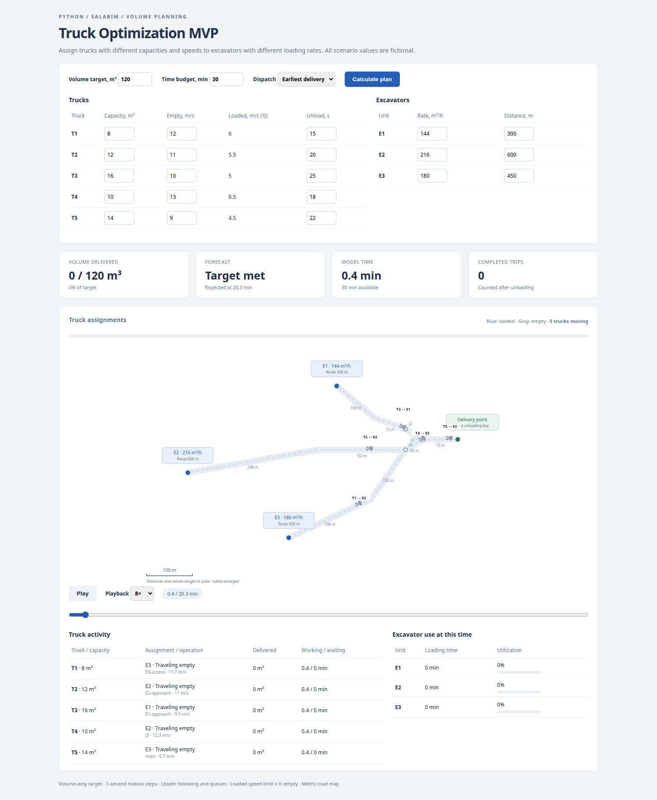
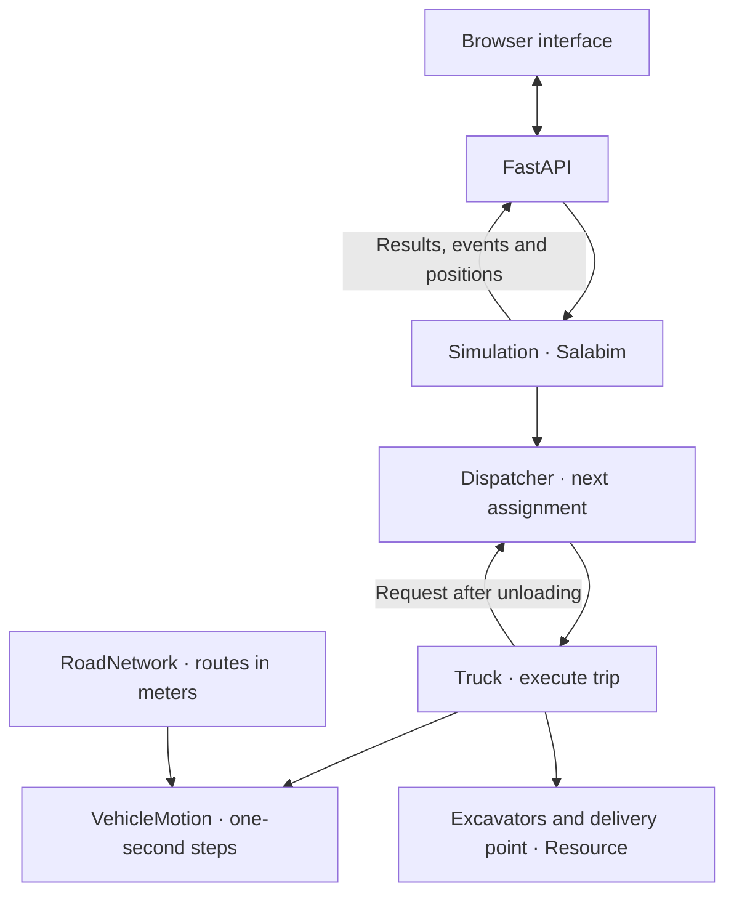

# Truck Optimization MVP (2024)

[English](README.md) | [Русский](README.ru.md)

Минимальный работоспособный продукт (MVP) для оптимизации работы самосвалов на Salabim и FastAPI. Распределяет машины с разной вместимостью и скоростью между несколькими экскаваторами для доставки заданного объема за доступное время. Все маршруты, техника и параметры вымышлены.



## Архитектура

`Simulation` запускает окружение Salabim. `Dispatcher` выдает каждому `Truck` следующее задание: экскаватор, маршрут к нему и объем груза. Самосвал едет, загружается, возвращается и разгружается, затем запрашивает новое задание. Назначения прекращаются, когда весь плановый объем доставлен или зарезервирован либо ни один рейс по оценке не укладывается в оставшееся время.



`RoadNetwork` хранит маршруты и расстояния. `VehicleMotion` рассчитывает следование за лидером, ускорение и обновление позиции. Объекты `Resource` в Salabim допускают одну машину за раз на погрузку у каждого экскаватора или на разгрузку в пункте доставки. FastAPI возвращает рассчитанные позиции и результаты, браузер отображает их на карте. CLI запускает `Simulation` напрямую.

## Модель

У каждого самосвала своя вместимость, предельная скорость порожнего хода и время разгрузки. Предельная скорость с грузом всегда вдвое ниже порожней. У каждого экскаватора своя производительность погрузки и расстояние до общего пункта доставки. Самосвалы начинают работу в пункте доставки, едут порожними к экскаватору, загружаются, возвращаются с грузом и разгружаются.

Диспетчер оценивает время следующей доставки для каждого экскаватора. В расчет входят движение, погрузка, зарезервированные интервалы обслуживания и разгрузка. Стратегия earliest-delivery выбирает вариант с самым ранним ожидаемым окончанием разгрузки. Для сравнения доступно назначение по кругу — round-robin.

Для оценки вариантов диспетчер резервирует ожидаемое время обслуживания. Фактическая погрузка и разгрузка начинаются после прибытия самосвала на свободный пункт. Каждый пункт обслуживает одну машину за раз. Время погрузки равно объему груза, деленному на производительность экскаватора.

Движение рассчитывается с шагом в одну секунду. На каждом шаге самосвал находит ближайшего лидера на своем маршруте, вычисляет ускорение по скорости и дистанции, обновляет скорость и позицию, затем переходит на следующий участок с сохранением пройденного сверх границы расстояния. Машины замедляются перед транспортом впереди и останавливаются у цели. Встречные направления используют отдельные полосы. Машина у пункта погрузки или разгрузки остается в полосе прибытия до отъезда.

Дороги образуют вымышленную сеть с общим участком, перекрестками и ответвлениями к экскаваторам. Координаты узлов и длины участков заданы в метрах: геометрическая длина каждого отрезка равна расстоянию дороги. Карта сохраняет единый масштаб по обеим осям и содержит масштабную линейку. Изменение расстояния до экскаватора перестраивает его маршрут. Кузов значка соответствует машине длиной 15 метров; подписи увеличены для удобства чтения. Груженые самосвалы возвращаются по тем же участкам в обратном порядке. Их предельная скорость вдвое ниже порожней; на время движения также влияют разгон, торможение и очереди.

Объем засчитывается в план только после завершения разгрузки. Уже назначенный самосвалам объем резервируется в счет плана. Последний груз может быть меньше вместимости кузова. Рейс назначается, только если ожидаемая разгрузка укладывается в доступное время.

Результат содержит доставленный объем, недобор, время достижения плана, число рейсов, время работы/ожидания/простоя самосвалов и загрузку экскаваторов. Если цель не достигнута, отображается остаток объема для выбранной стратегии. Earliest-delivery — жадная эвристика; она не устанавливает глобальный оптимум и не доказывает физическую невозможность невыполненного плана. В этой версии цель задается объемом; качество материала и смешивание пока не учитываются.

## Стек

Python 3.11+, Salabim 26.0.8 и браузерный интерфейс на HTML, CSS и JavaScript. API использует FastAPI и Pydantic, сервер запускается через Uvicorn. Процессы Salabim используют `yield` и `Environment(yieldless=False)`; см. [документацию генераторного режима](https://salabim.org/manual_yield/Overview.html).

## Запуск

Из каталога проекта:

```bash
python -m venv .venv
source .venv/bin/activate
python -m pip install -e .
python -m truck_cycle.web
```

Откройте [http://127.0.0.1:8765](http://127.0.0.1:8765). Измените целевой объем, доступное время и характеристики техники, затем рассчитайте план. Пауза, скорость воспроизведения и ползунок времени позволяют изучить назначения и очереди. Остановка сервера — Ctrl+C. API сценария поддерживает от одного до шести самосвалов и от одного до четырех экскаваторов; форма редактирует заданный парк.

Браузер воспроизводит позиции и события, рассчитанные Salabim. Для плавной анимации он интерполирует записанные позиции, а не рассчитывает движение самостоятельно. Прогноз показывает итог расчета; доставленный объем и работа техники соответствуют выбранному модельному времени. Работа самосвала включает движение (в том числе остановки в потоке), погрузку и разгрузку; ожидание показано отдельно. Загрузка экскаватора равна времени погрузки, деленному на прошедшее модельное время.

Или используйте Conda из каталога проекта:

```bash
conda env create -f environment.yml
conda activate truck-cycle-demo
python -m truck_cycle.web
```

Расчет для стандартного парка из командной строки:

```bash
python -m truck_cycle --target 120 --duration 1800
python -m truck_cycle --target 120 --duration 1800 --policy round_robin
python -m truck_cycle --target 120 --duration 1800 --events
```

`--target` задается в кубических метрах; `--duration` — в секундах. У стандартного вымышленного парка пять самосвалов вместимостью 8, 12, 16, 10 и 14 м³, производительность трех экскаваторов — 144, 216 и 180 м³/ч. Индивидуальные характеристики меняются в форме или при создании `Scenario` с `TruckSpec` и `ExcavatorSpec` в Python. Все числовые параметры должны быть конечными и положительными.

## API

При запущенном сервере доступны [интерактивная документация API](http://127.0.0.1:8765/docs) и [схема OpenAPI](http://127.0.0.1:8765/openapi.json).

- `GET /api/defaults` возвращает вымышленный сценарий.
- `POST /api/simulate` принимает типизированный сценарий и возвращает план, метрическую сеть, назначения, события и пошаговые позиции. Временные отметки назначения отражают фактический ход работы; незавершенные этапы равны `null`. Поле `predicted_finish` — оценка диспетчера, которая может отличаться от фактического завершения.
- Некорректные сценарии возвращают HTTP 400 с сообщением `error` для браузера.

Прежняя команда запуска поднимает Uvicorn. Также можно запустить ASGI-приложение напрямую:

```bash
uvicorn truck_cycle.web:app --host 127.0.0.1 --port 8765
```

Запросы расчета выполняются в рабочих потоках последовательно в пределах процесса: Salabim хранит общее окружение по умолчанию.

## Файлы и проверки

- [src/truck_cycle/model.py](src/truck_cycle/model.py): техника, план, резервирование назначений, процессы Salabim и результаты.
- [src/truck_cycle/motion.py](src/truck_cycle/motion.py): поиск лидера, ускорение, ограничения скорости и пошаговое обновление позиции.
- [src/truck_cycle/network.py](src/truck_cycle/network.py): общие узлы дорог, участки и маршруты к местам погрузки.
- [src/truck_cycle/web.py](src/truck_cycle/web.py): маршруты FastAPI и точка запуска Uvicorn.
- [src/truck_cycle/schemas.py](src/truck_cycle/schemas.py): типизированные схемы запросов и ответов.
- [src/truck_cycle/static/index.html](src/truck_cycle/static/index.html): параметры техники, анимация и таблицы активности.
- [src/truck_cycle/__main__.py](src/truck_cycle/__main__.py): командная строка.
- [tests/test_model.py](tests/test_model.py): баланс объема, вместимость, расписания обслуживания, граница времени, связность маршрутов, одновременное движение и проверка параметров.
- [tests/test_motion.py](tests/test_motion.py): уравнения шага, следование за лидером, разделение полос, переходы между участками и остановка.
- [tests/test_web.py](tests/test_web.py): ответы API, проверка параметров и независимость одновременных запросов.
- [environment.yml](environment.yml): дополнительный вариант окружения через Conda.

Установите зависимости для тестов и выполните:

```bash
python -m pip install -e ".[test]"
python -m unittest discover -s tests -v
```

## Лицензия

Copyright (c) 2024 Ivan Zamula. Проект распространяется по пользовательской [Ivan Zamula Attribution License 1.0](LICENSE).

Копирование и распространение проекта или его существенной части, в том числе измененных версий, требуют указания автора Ivan Zamula и ссылки на [исходный репозиторий](https://github.com/ivan-zamula/truck-optimization-mvp-2024). Сохраняйте лицензию и уведомление об авторских правах. Там, где формат поддерживает ссылки, делайте ссылку кликабельной; в обычном тексте указывайте полный URL. Копирование без обязательного указания источника не разрешено этой лицензией.

Указывайте источник в README или аналогичной документации. Для отдельного файла или фрагмента используйте комментарий либо сопроводительное уведомление. Для бинарных сборок и размещенных приложений используйте доступную страницу About, Credits или документации. Файл [NOTICE](NOTICE) содержит текст указания источника, который нужно сохранять. Сторонние зависимости сохраняют собственные лицензии. Полные условия приведены в [LICENSE](LICENSE).
